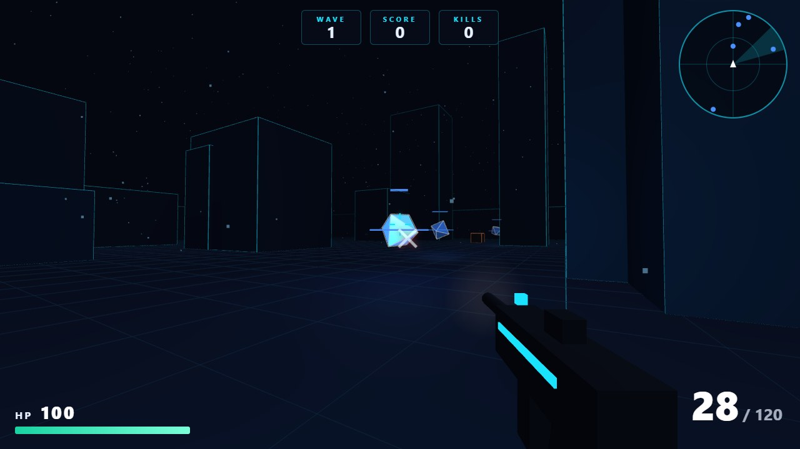

# Core Breach

[](https://github.com/Zubair-hussain/Core-Breach/actions/workflows/ci.yml)
[](https://github.com/Zubair-hussain/Core-Breach/actions/workflows/deploy.yml)
[](LICENSE)


A free first-person shooter that runs in your browser. Three rogue AI cores have taken a neon city. Survive the waves and push your high score.

**[Play now → core-breach.netlify.app](https://core-breach.netlify.app)**



- No install, no account, no download
- No asset files: every model is built from three.js shapes and every sound is synthesised live with the Web Audio API
- Works offline after the first visit
- About 3,000 lines of readable, tested JavaScript with no build step

## Play

| Key        | Action                 |
| ---------- | ---------------------- |
| `W A S D`  | Move                   |
| `Shift`    | Sprint (less accurate) |
| `Space`    | Jump                   |
| Mouse      | Aim                    |
| Left click | Shoot (hold for auto)  |
| `R`        | Reload                 |
| `Esc`      | Pause                  |

Core Breach needs a keyboard and a mouse. Use Chrome, Edge or Firefox on a computer.

## The cores

| Core        | Colour | Behaviour                                              |
| ----------- | ------ | ------------------------------------------------------ |
| **Crystal** | orange | Tanky. Keeps its distance and fires heavy, slow bolts. |
| **Prism**   | blue   | Fragile but fast. Rams you at close range.             |
| **Knot**    | green  | Circles around you and fires 3-shot bursts.            |

Destroyed cores sometimes drop **ammo** (yellow box) or **health** (green gem). Each wave brings more cores, and they get 8% tougher per wave.

## Run it locally

You need [Node.js](https://nodejs.org) 22 or newer.

```bash
git clone https://github.com/Zubair-hussain/Core-Breach.git
cd Core-Breach
npm start
```

Open http://localhost:8080. The game uses ES modules, which browsers won't load from `file://`, so open it through `npm start` rather than double-clicking `index.html`.

To work on the code:

```bash
npm install     # dev tools only: eslint, prettier
npm test        # unit tests (node:test, no extra dependencies)
npm run ci      # lint + format check + tests + asset check, the same as CI
```

## How it's built

| Library                               | Used for                                                                 |
| ------------------------------------- | ------------------------------------------------------------------------ |
| [three.js](https://threejs.org) r128  | 3D city, cores, rifle model, lights, particles, raycast hits             |
| [GSAP](https://gsap.com) 3.12.5       | Rifle recoil and reload, camera shake, core spawn and death scaling      |
| [anime.js](https://animejs.com) 3.2.1 | HUD motion: wave banners, hit marker, damage flash, score pop-ups, title |

The libraries are vendored in `public/lib/`, so there is no bundler, no CDN and nothing to install to play.

```
public/
├── index.html
├── css/                 base, hud, menu, responsive
├── js/
│   ├── main.js          entry point
│   ├── config.js        every tuning number in one file
│   ├── core/            renderer, scene, player rig, game loop
│   ├── world/           arena, city, props, collision, line of sight
│   ├── enemies/         core types, AI steering, spawning, bolts, combat
│   ├── weapon/          rifle, recoil, viewmodel
│   ├── player/          movement
│   ├── pickups/         ammo and health drops
│   ├── game/            state, waves, scoring, flow, best-score storage
│   ├── audio/           Web Audio synthesis
│   ├── fx/              particles, tracers, camera shake
│   ├── input/           keyboard, mouse, pointer lock
│   ├── ui/              HUD, banner, kill feed, radar, menus
│   └── utils/           math, seeded random, colour, DOM
├── lib/                 vendored three.js, GSAP, anime.js
└── sw.js                offline cache
tests/                   unit tests for everything that doesn't need a GPU
scripts/                 local server and the pre-deploy asset check
docs/                    architecture and deployment guides
```

Read [docs/ARCHITECTURE.md](docs/ARCHITECTURE.md) for how a frame flows through the code.

## Tweak the game

Open `public/js/config.js`. Fire rate, damage, wave size, pickup chances and player speed are all there. Change a number, refresh, and play.

## Deploy

Every push to `_Prod` is verified by CI and deployed to Netlify. Every pull request gets a preview link. See [docs/DEPLOYMENT.md](docs/DEPLOYMENT.md) for the one-time setup.

## Ideas to extend it

See the open [issues](https://github.com/Zubair-hussain/Core-Breach/issues) and the [Discussions](https://github.com/Zubair-hussain/Core-Breach/discussions) board. Good first picks:

- A second weapon (shotgun or sniper) with its own recoil curve
- Headshots, with a weak spot on each core
- Touch controls for phones
- A shared online leaderboard

## Contributing

Pull requests are welcome. Start with [CONTRIBUTING.md](CONTRIBUTING.md).

## Author

Built by [Zubair Hussain](https://zubairhussain.xyz), a web developer in Hyderabad, Pakistan.

## License

The game code is [MIT](LICENSE). The bundled libraries keep their own licenses, listed in [public/lib/THIRD_PARTY_LICENSES.md](public/lib/THIRD_PARTY_LICENSES.md).
